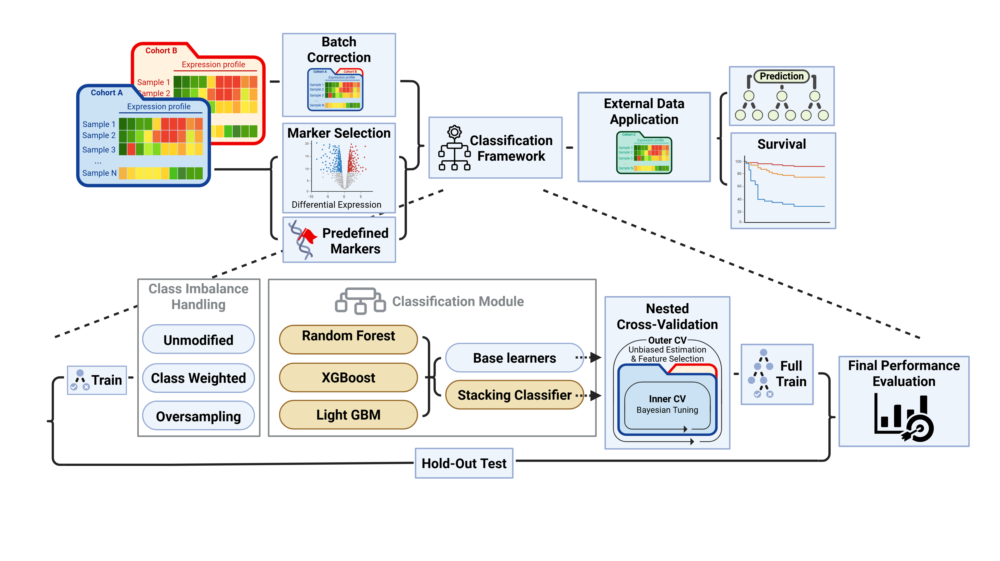

# Omiclass

Omiclass is a configurable machine-learning framework for omics classification tasks. It trains and evaluates multiple classifiers on gene-expression style input data, supports imbalance handling methods, and writes model outputs and reports to a results directory.

The framework is designed to run either directly with Python or inside Docker, so the same analysis can be reproduced on a local machine, a lab server, or a clean container environment.

## Main features

- Expression-based classification from tabular input files
- Train/test splitting and cross-validation
- Bayesian hyperparameter optimization
- Random Forest, LightGBM, XGBoost and stacked classifer models
- Imbalance handling using class weights and oversampling strategies
- Output folders with trained models, predictions, metrics, and reports

## Framework Overview


## Repository structure

```text
omiclass/
├── omiclass/              # Framework source code
├── examples/              # Example commands and small example config files
├── api.py.                # Framework entery point
├── Dockerfile             # Docker image definition
├── environment.yml.txt    # Dependencies
├── README.md              # This file
├── .gitignore
├── .dockerignore
└── LICENSE
```

## Input files

The framework expects at least two input tables:

1. **Expression file**
   - Rows should represent samples or patient according to the selected loader/configuration.
   - Columns should contain the features used for classification.
   - Example: `filtered_count.csv`

2. **Metadata file**
   - Contains sample-level labels and optional covariates.
   - Must include the classification label column.
   - Example: `filtered_meta.csv`

For example, for IGHV classification, the metadata file should contain a label column such as:

```text
ighv_mut
```

Batch correction is optional. If you do not provide any batch-related settings such as `batch_column`, `batch_covariates_path`, or `batch_n_pcs`, the batch-correction step is skipped.

Training-reference alternatives are available through `batch_correction.algorithm`:
`frozen_quantile`, native `fsva_exact`, and experimental `reference_ruv`.
They fit on explicitly listed training samples and support independent external
application through the existing prediction workflow. The default is `limma`;
`none` explicitly disables correction. See the [methods, configuration and limitations](docs/reference_preprocessing.md)
and [CLL-Map → DKFZ comparison commands](experiments/reference_preprocessing/README.md).
If you provide `markers_path` with a predefined gene list, Omiclass skips DE and gene-set selection and uses that list directly.

## Quick start with Docker

Build the Docker image from the repository root:

```bash
docker build -t omiclass:dev .
```

Create local folders for input and output:

```bash
mkdir -p data results
```

Place your input files in `data/`, for example:

```text
data/filtered_count.csv
data/filtered_meta_ighv.csv
```

Run the framework:

```bash
docker run --rm \
  -v "$PWD/data:/app/data" \
  -v "$PWD/results:/app/results" \
  omiclass:dev \
  --override expression_file /app/data/filtered_count.csv \
  --override meta_path /app/data/filtered_meta_ighv.csv \
  --override output_dir /app/results \
  --override class_col ighv_mut \
  --override de_covariates age,sex
```

The input files remain on your server/local machine. The results are written to the mounted `results/` folder.

### Rerun using Docker for prediction on a new dataset

You can rerun an existing pipeline on another dataset that was prepared using the same preprocessing steps as the original run.  
This is useful when you already trained the pipeline and want to apply the same saved models, selected genes, normalization/batch settings, and report structure to a new input dataset.

When using Docker, mount the folder that contains the new input data and the previous output directory. Then pass the existing pipeline directory as `output_dir`.


```bash
docker run --rm \
  -v "$PWD/data:/app/data" \
  -v "$PWD/results:/app/results" \
  omiclass:dev \
  --override expression_file /app/data/filtered_count.csv \
  --override output_dir /app/data/<Existing_pipeline> \
  --override meta_path /app/data/merged_meta_cll.csv
```

The mounted directory is shared with the server, so the updated reports and outputs will be written back to the existing pipeline folder.

## Quick start with Python

You can run Omiclass directly from Python by importing the `run` function from `api.py`.

Example file: `examples/python_example.py`

```python
from pathlib import Path

from api import run

base_dir = Path(__file__).resolve().parent.parent

expression_file = f"{base_dir}/data/filtered_counts.csv"

kwargs = {
    "output_dir": f"{base_dir}/results",
    "meta_path": f"{base_dir}/data/filtered_meta_ighv.csv",
    "class_col": "ighv_mut",
    "batch_column": "cohort",
    "de_covariates": ["age", "sex"],
    "n_jobs": 5,
}

run(expression_file, **kwargs)
```

From the project root:
```bash
cd examples
```
Create conda environment
```bash
conda env create -f ../environment.yml
conda activate omiclass_env
```
Run the example 
```bash
python python_example.py
```

The main input expression file is passed as the first argument to `run()`.  
Additional parameters are passed as keyword arguments through `**kwargs`.

## Quick start with Bash

You can run the `run` function from `api.py` from bash.
```bash
python api.py \
--override expression_file <data_path>/raw_counts.csv \
--override output_dir <data_path>/results \
--override meta_path <data_path>/patients_meta.csv \
--override class_col class \
--override batch_column batch \
--override de_covariates age,sex \
```

## Example folder

The `examples/` folder contains:

```text
examples/
├── README.md
├── run_bash_example.sh
├── run_bash_re_run_example.sh
├── run_docker_example.sh
├── run_docker_re_run_example.sh
├── run_python_example.py
└── run_python_re_run_example.py
├── image/
├── results/
│   ├── Docker_results
│   ├── Bash_results
│   └── Python_results
└── data/
    ├── gene_lengths.csv
    ├── patients_meta.csv
    ├── patients_meta_with_external.csv
    ├── raw_counts.csv
    ├── raw_counts_with_external.csv
    └── README.md
```

Use the example script as a template and replace the input paths, label column, and covariates with the values for your project.

## Configuration
Parameters are set through the public alias names.

The same aliases can be used in two ways:

1. **Python API**: pass parameters as keyword arguments (`**kwargs`).
2. **Docker/CLI**: pass parameters with repeated `--override` arguments.

For example, the user-facing alias `output_dir` maps internally to `project.out_dir`, and `class_col` maps internally to `project.cluster_column`. The user should set the alias name, not the internal nested path.

Main fields includes:

```yaml
expression_file: path to the expression matrix
output_dir: path to the output directory
meta_path: path to the metadata file
class_col: metadata column used as the classification label
batch_column: metadata column used for batch correction
n_jobs: number of CPU jobs to use
```

### CellFM embedding backend

CellFM can replace BulkFormer at the sample-embedding stage. It consumes raw,
non-negative RNA-seq counts with genes in rows and samples in columns. Gene IDs
are matched exactly to CellFM's `expand_gene_info.csv` vocabulary. The pretrained
model is frozen and valid gene-token outputs are mean-pooled for each sample.

Enable one embedding backend only. CellFM uses the same downstream representation
transformer and supports `full`, `supervised`, `pca`, and `supervised_pca`:

```python
run(
    "data/raw_counts.csv",
    output_dir="results/cellfm_run",
    meta_path="data/patients_meta.csv",
    class_col="class",
    cellfm_enabled=True,
    cellfm_root_dir="CellFM/CellFM-torch",
    cellfm_checkpoint_path="CellFM/weights/CellFM_80M_weight.ckpt",
    cellfm_device="auto",
    cellfm_batch_size=1,
    cellfm_reduction_strategy="supervised_pca",
    cellfm_supervised_dimensions=200,
    cellfm_pca_components=50,
    feature_selection_enabled=False,
)
```

`feature_selection_enabled` must be false for every non-`full` embedding
strategy. The Python environment running Omiclass must also provide CellFM's
PyTorch and MindSpore dependencies.

## Manuscript foundation-model API

The opt-in `foundation` configuration exposes pooled and token representations with their distinct manuscript head protocols through `api.py`. See [configuration matrix, training protocols and saved prediction](docs/foundation-api.md). Existing marker-based calls retain their original route.
