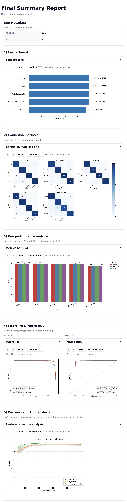
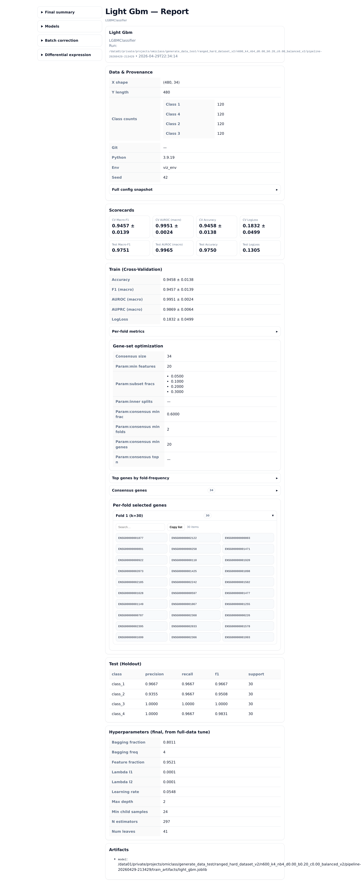
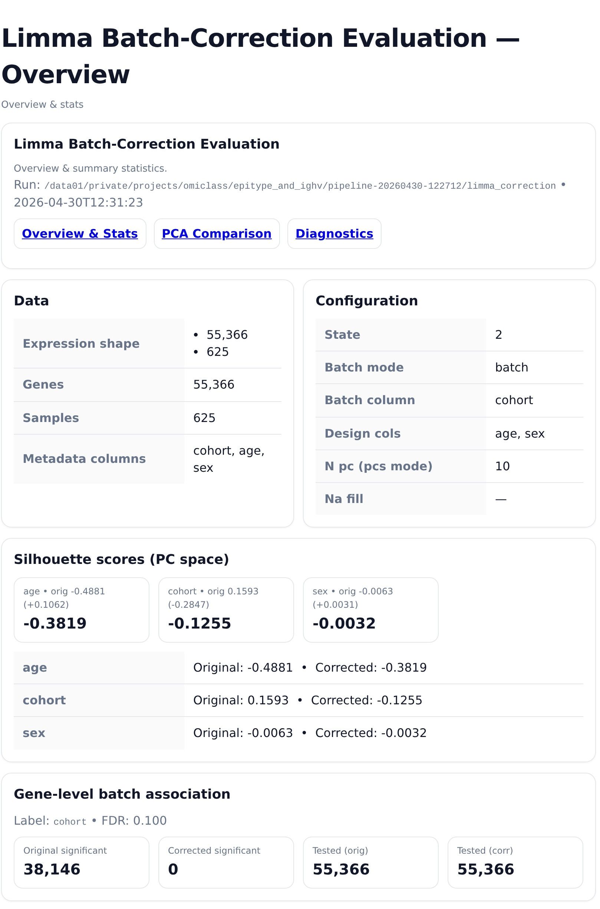
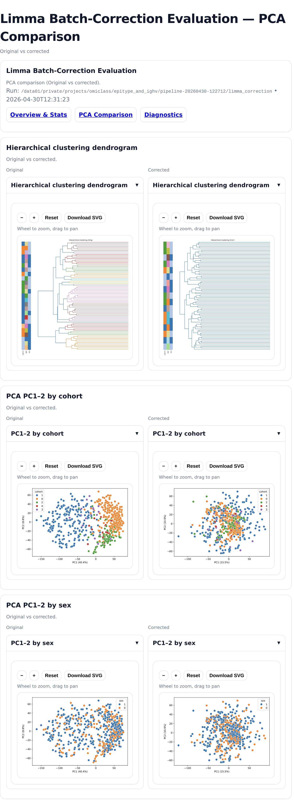
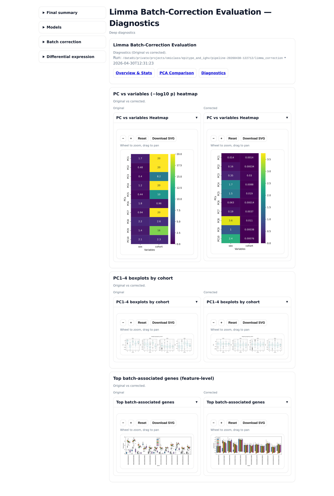
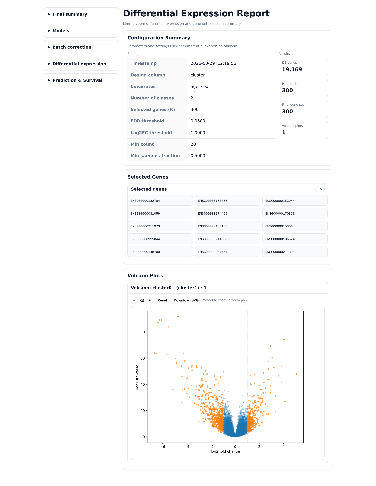
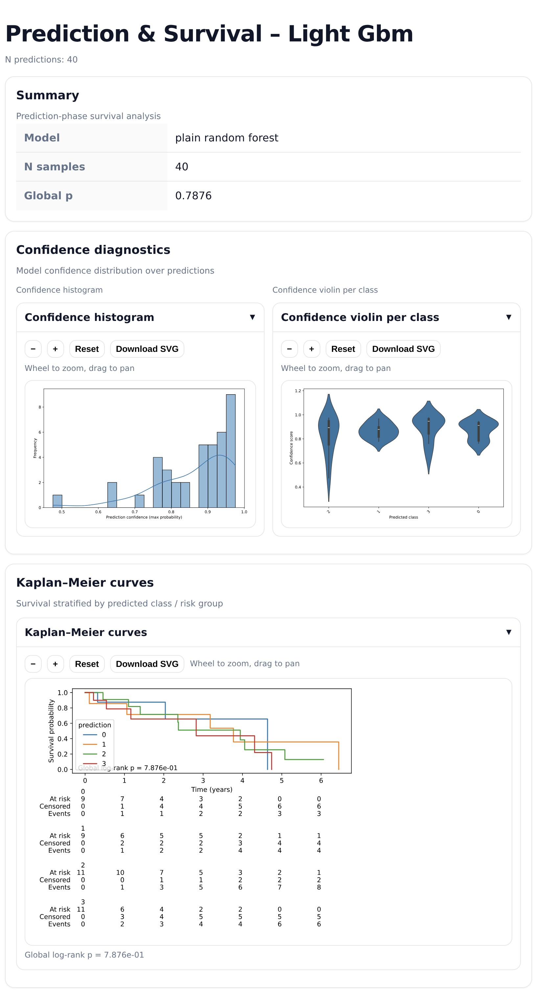

# Examples

This folder contains minimal examples for running OmiClass with either Python or Docker.

## Run with Python

From the project root:
```bash
cd examples
```
Create conda environment
```bash
conda env create -f ../environment.yml
conda activate omiclass_env
```
Run the example 
```bash
python run_python_example.py
```

### Rerun using Python
```bash
cd examples
conda activate omiclass_env
python run_python_re_run_example.py
```

## Run with Docker

From the project root:
```bash
cd examples
```
Run the example 
```bash
bash run_docker_example.sh
```

### Rerun using Docker
```bash
cd examples
bash run_docker_re_run_example.sh
```
## Run with Bash
From the project root:
```bash
cd examples
```
Create conda environment
```bash
conda env create -f ../environment.yml
conda activate omiclass_env
```
Run the example 
```bash
bash run_bash_example.sh
```
### Rerun using Bash
```bash
cd examples
conda activate omiclass_env
python run_bash_re_run_example.sh
```
# Parameters

### Main parameters

These parameters define the main input files, output location, label column, and optional batch/gene-selection behavior.

| Parameter | Explanation | Values |
|---|---|---|
| `expression_file` | Path to the main expression matrix. This is passed as the first argument to `run()`, not inside `kwargs`. | Path to CSV/TSV file |
| `output_dir` | Directory where all results and reports will be saved. | Path |
| `meta_path` | Path to the metadata file. | Path to CSV/TSV file |
| `class_col` | Metadata column used as the classification label. | Column name |
| `classification_column` | Alias for `class_col`. Metadata column used as the classification label. | Column name |
| `batch_column` | Metadata column representing the batch/cohort variable. Used for batch correction and batch-effect assessment when batch correction is enabled. | Column name |
| `de_covariates` | Covariates included in differential expression analysis. | Comma-separated column names, e.g. `age,sex` |
| `n_jobs` | Number of CPU jobs/threads to use. | Integer |
| `project_name` | Name of the project/run. Used in reports and output organization. | Text string |
| `classes_names` | Optional display names for the classes in plots and reports. | List of class names |
| `random_state` | Random seed for reproducibility. | Integer |
| `cv_folds` | Number of cross-validation folds. | Integer |
| `split_ratio` | Fraction of samples used for training when splitting the data. | Float between 0 and 1 |
| `split_method` | Method used to split the dataset. | Example: `stratified`, `random` |
| `log_transform` | Whether to apply log transformation to the expression matrix. | `true` / `false` |
| `raw_count` | Whether the input expression matrix contains raw counts. | `true` / `false` |
| `test_holdout_path` | Optional path to an external holdout/test dataset. | Path |
| `markers_path` | Path to a predefined gene list or gene set. Providing this disables DE and gene-set selection and uses the supplied list directly. | Path |

More advanced / optional parameters at the bottom

Batch correction is optional: if you omit all batch-related settings (`batch_column`, `batch_covariates_path`, and `batch_n_pcs`), the batch-correction step will not run.
Likewise, setting `markers_path` to a predefined gene list disables DE and gene-set selection.

## Example Output Reports

After running the example, Omiclass generates several interactive HTML reports.  
The reports are linked through the left sidebar and can be opened directly from the output directory.

The main reports are:

1. Final Summary Report
2. Model Reports
3. Batch Correction Reports
4. Differential Expression Report
5. Prediction and Survival Report

Each report contains interactive SVG figures with zoom, pan, reset, and download options.

---

## 1. Final Summary Report


The final summary report provides a global overview of the model comparison and the final prediction performance.

### Run Metadata

Shows the main run information, including:

- Number of test samples
- Number of classes
- Main configuration values used in the run

### 1) Leaderboard

Ranks all trained models according to the selected main metric, usually macro F1.

This plot is used to quickly compare the overall performance of all models.

### 2) Confusion Matrices

Shows one row-normalized confusion matrix for each model.

This plot is used to inspect which classes are predicted correctly and which classes are confused with one another.

### 3) Key Performance Metrics

Shows the main evaluation metrics for each model, including:

- Accuracy
- Precision
- Recall
- Macro F1
- AUROC or AUPRC when available

This plot gives a compact comparison of model performance across several metrics.

### 4) Macro PR and Macro ROC

Shows macro-averaged Precision-Recall and ROC curves across the models.

The Macro PR curve evaluates performance under class imbalance and focuses on precision and recall.  
The Macro ROC curve evaluates the tradeoff between true positive rate and false positive rate.

### 5) Feature Reduction Analysis

Shows model performance as a function of the number of selected genes.

This plot is used to check whether the model can maintain strong performance with fewer genes, and to evaluate how sensitive the model is to feature reduction.

---

## 2. Model Reports


A separate report is generated for each trained model, for example LightGBM, XGBoost, Random Forest, or the stacked ensemble.

### Data and Provenance

Shows the training data dimensions, class counts, Python environment, random seed, and run information.

This section helps track exactly which data and settings were used for the model.

### Scorecards

Summarizes the main cross-validation and test performance metrics.

This section provides a quick comparison between internal CV performance and final holdout performance.

### Train Cross-Validation

Shows the mean and standard deviation of the cross-validation metrics.

This is used to evaluate model stability across folds.

### Gene-Set Optimization

Shows the selected feature-set settings used during model training.

This includes the final consensus gene set size and the parameters used for selecting stable genes across folds.

### Top Genes by Fold Frequency

Lists genes that were repeatedly selected across cross-validation folds.

Genes selected more frequently are considered more stable and more important for the classification task.

### Consensus Genes

Shows the final gene set used by the model.

This is the final selected feature set after cross-validation based gene selection.

### Per-Fold Selected Genes

Shows which genes were selected in each fold.

This helps evaluate whether the selected gene set is stable or changes strongly between folds.

### Test Holdout Classification Report

Shows per-class precision, recall, F1 score, and support on the held-out test set.

This section is used to inspect class-specific performance.

### Hyperparameters

Shows the final hyperparameters selected after tuning.

This helps make the model reproducible.

---

## 3. Batch Correction Reports

The batch correction reports evaluate the effect of limma batch correction by comparing the original and corrected expression matrices.

The batch correction output is split into:

1. Overview
2. PCA Comparison
3. Diagnostics

---

## 3.1 Batch Correction Overview


### Data

Shows the expression matrix dimensions, number of genes, number of samples, and metadata columns used in the correction.

### Configuration

Shows the batch correction settings, including:

- Batch mode
- Batch column
- Design columns
- Number of PCs used
- Missing value handling

### Silhouette Scores in PC Space

Compares sample separation before and after correction.

The scores are calculated for metadata variables such as cohort, age, or sex.

A reduction in batch-related separation after correction suggests that batch effects were reduced.

### Gene-Level Batch Association

Counts how many genes are significantly associated with the batch variable before and after correction.

This section checks whether the correction reduced gene-level batch signal.

---

## 3.2 Batch Correction PCA Comparison


### Hierarchical Clustering Dendrogram

Compares sample clustering before and after correction.

This plot is used to check whether samples cluster mainly by batch before correction, and whether this structure is reduced after correction.

### PCA PC1-2 by Cohort

Shows the first two principal components colored by cohort before and after correction.

This plot checks whether cohort-driven separation is reduced after batch correction.

### PCA PC1-2 by Sex

Shows the first two principal components colored by sex before and after correction.

This plot checks whether biological or metadata-associated structure is preserved or changed by the correction.

---

## 3.3 Batch Correction Diagnostics


### PC vs Variables Heatmap

Shows the association between principal components and metadata variables before and after correction.

This plot helps identify whether major PCs are driven by batch-related variables.

After correction, batch-associated PC signals should be reduced, while relevant biological signals should ideally be preserved.

### PC1-4 Boxplots by Cohort

Shows the distribution of the first four PCs across cohorts before and after correction.

This plot checks whether cohort-specific shifts in PC space were reduced by the correction.

### Top Batch-Associated Genes

Shows genes most strongly associated with the batch variable before and after correction.

This plot evaluates whether gene-level batch effects were removed or reduced.

---

## 4. Differential Expression Report


The differential expression report summarizes the limma-voom differential expression analysis and the gene-set selection step.

### Configuration Summary

Shows the main differential expression settings, including:

- Design column
- Covariates
- Number of classes
- Selected genes
- FDR threshold
- log2 fold-change threshold
- Minimum count filter
- Minimum sample fraction

It also reports the number of detected DE genes, selected pan markers, final gene-set size, and number of volcano plots.

### Selected Genes

Shows the final selected genes used downstream by the framework.

This section provides the gene identifiers selected by the DE-based gene selection step.

### Volcano Plots

Shows differential expression results for each contrast.

The x-axis shows log2 fold change.  
The y-axis shows statistical significance as `-log10(p-value)`.

Genes passing the selected fold-change and significance thresholds are highlighted.

This plot is used to inspect the strength and direction of differential expression between classes.

---

## 5. Prediction and Survival Report


The prediction and survival report evaluates model predictions in relation to survival outcome when survival metadata is provided.

### Summary

Shows the model name, number of prediction samples, and the global survival test p-value.

This section summarizes whether predicted classes or risk groups show survival differences.

### Confidence Diagnostics

#### Confidence Histogram

Shows the distribution of model prediction confidence.

This plot is used to check whether predictions are generally high-confidence or uncertain.

#### Confidence Violin per Class

Shows prediction confidence grouped by predicted class.

This plot helps identify classes where the model is more or less confident.

### Kaplan-Meier Curves

Shows survival curves stratified by predicted class or predicted risk group.

This plot evaluates whether the predicted groups are associated with different survival outcomes.

The report also includes the global log-rank p-value and the number of patients at risk over time.

### Advanced / optional parameters

These parameters control advanced behavior such as batch-correction details, feature selection, survival prediction, differential expression thresholds, normalization, and model-specific search spaces.

| Parameter | Explanation | Values |
|---|---|---|
| `split_output_dir` | Directory for saving split train/test data. | Path |
| `design_columns` | Metadata columns to preserve during batch correction. | Column name or list of columns |
| `batch_covariates_path` | Path to additional covariates used for batch correction. | Path |
| `batch_n_pcs` | Number of principal components to evaluate during batch assessment. | Integer |
| `batch_fill_na` | Whether/how to fill missing values in batch covariates. | Boolean or fill strategy |
| `min_features` | Minimum number of features allowed in feature-based steps. | Integer |
| `bayesian_iterations` | Number of Bayesian optimization iterations. | Integer |
| `feature_selection_enabled` | Enable or disable feature selection. | `true` / `false` |
| `feature_selection_min_features` | Minimum number of features to keep during feature selection. | Integer |
| `feature_selection_max_features` | Maximum number of features to keep during feature selection. | Integer |
| `feature_selection_subset_fracs` | Fractions of features to test during feature selection. | List of floats |
| `feature_selection_consensus_top_n` | Number of top features considered for consensus selection. | Integer |
| `feature_selection_consensus_min_fraction` | Minimum fraction required for a feature to be included in the consensus set. | Float between 0 and 1 |
| `feature_selection_consensus_min_folds` | Minimum number of folds in which a feature must appear. | Integer |
| `feature_selection_consensus_min_genes` | Minimum number of genes required in the final consensus set. | Integer |
| `survival_prediction_enabled` | Enable or disable survival prediction analysis. | `true` / `false` |
| `survival_time_column` | Metadata column containing survival time. | Column name |
| `survival_event_column` | Metadata column containing event status. | Column name |
| `survival_prediction_expression_path` | Path to the expression matrix used for survival prediction. | Path |
| `survival_prediction_time_scale` | Time scale used for survival analysis. | Example: `days`, `months`, `years` |
| `feature_reduction_enabled` | Enable or disable feature reduction analysis. | `true` / `false` |
| `feature_reduction_ratios` | Ratios of selected features to test during feature reduction. | List of floats |
| `feature_reduction_repeats` | Number of repeats for feature reduction analysis. | Integer |
| `feature_reduction_min_features` | Minimum number of features allowed during feature reduction. | Integer |
| `de_min_samples` | Minimum sample fraction required for differential expression analysis. | Float between 0 and 1 |
| `de_k_genes` | Number of top differentially expressed genes to report. | Integer |
| `de_logfc` | Log fold-change threshold for differential expression. | Float |
| `de_fdr` | FDR threshold for differential expression. | Float, e.g. `0.05` |
| `gene_lengths_path` | Path to gene length annotation file used for normalization. | Path |
| `gene_lengths_version` | Gene annotation version used for gene lengths. | Example: `v19`, `v34` |
| `gencode_version` | GENCODE annotation version. | Example: `v19`, `v34` |
| `gtf_path` | Path to a GTF annotation file. | Path |
| `surface_markers_enabled` | Enable or disable surface marker annotation. | `true` / `false` |
| `rf_oob_score` | Enable out-of-bag scoring for Random Forest. | `true` / `false` |
| `rf_calibrate` | Enable probability calibration for Random Forest. | `true` / `false` |
| `rf_calibration_method` | Calibration method for Random Forest probabilities. | Example: `sigmoid`, `isotonic` |
| `rf_search_n_estimators` | Search space for the number of trees in Random Forest. | List or range of integers |
| `rf_search_max_depth` | Search space for maximum tree depth in Random Forest. | List of integers or `None` |
| `rf_search_max_features` | Search space for the number of features considered at each split. | Example: `sqrt`, `log2`, float |
| `rf_search_min_samples_leaf` | Search space for minimum samples per leaf. | List of integers |
| `rf_search_min_samples_split` | Search space for minimum samples required to split a node. | List of integers |
| `lgbm_early_stopping` | Early stopping rounds for LightGBM. | Integer |
| `lgbm_metric` | Evaluation metric for LightGBM. | Example: `multi_logloss`, `binary_logloss` |
| `lgbm_grid_learning_rate` | LightGBM learning-rate search values. | List of floats |
| `lgbm_grid_num_leaves` | LightGBM number-of-leaves search values. | List of integers |
| `lgbm_grid_max_depth` | LightGBM maximum-depth search values. | List of integers |
| `lgbm_grid_feature_fraction` | Fraction of features used by LightGBM. | List of floats between 0 and 1 |
| `lgbm_grid_bagging_fraction` | Fraction of samples used for LightGBM bagging. | List of floats between 0 and 1 |
| `lgbm_grid_n_estimators` | Number of LightGBM trees/boosting rounds. | List of integers |
| `lgbm_grid_min_child_samples` | Minimum number of samples per LightGBM leaf. | List of integers |
| `lgbm_grid_bagging_freq` | Frequency of LightGBM bagging. | List of integers |
| `lgbm_grid_lambda_l1` | L1 regularization values for LightGBM. | List of floats |
| `lgbm_grid_lambda_l2` | L2 regularization values for LightGBM. | List of floats |
| `xgb_filename` | Filename used for saving/loading XGBoost model artifacts. | Filename |
| `xgb_early_stopping` | Early stopping rounds for XGBoost. | Integer |
| `xgb_grid_learning_rate` | XGBoost learning-rate search values. | List of floats |
| `xgb_grid_n_estimators` | Number of XGBoost trees/boosting rounds. | List of integers |
| `xgb_grid_max_depth` | XGBoost maximum-depth search values. | List of integers |
| `xgb_grid_min_child_weight` | XGBoost minimum child weight search values. | List of floats or integers |
| `xgb_grid_gamma` | XGBoost minimum loss reduction values. | List of floats |
| `xgb_grid_reg_alpha` | XGBoost L1 regularization values. | List of floats |
| `xgb_grid_reg_lambda` | XGBoost L2 regularization values. | List of floats |
| `xgb_grid_subsample` | Fraction of samples used by XGBoost. | List of floats between 0 and 1 |
| `xgb_grid_colsample_bytree` | Fraction of features sampled per tree. | List of floats between 0 and 1 |
| `xgb_grid_colsample_bylevel` | Fraction of features sampled per tree level. | List of floats between 0 and 1 |
| `xgb_grid_colsample_bynode` | Fraction of features sampled per split node. | List of floats between 0 and 1 |
| `xgb_metric` | Evaluation metric for XGBoost. | Example: `mlogloss`, `logloss`, `auc` |
| `ensemble_filename` | Filename used for saving/loading stacked ensemble artifacts. | Filename |
| `ensemble_max_iter` | Maximum iterations for the ensemble logistic regression model. | Integer |